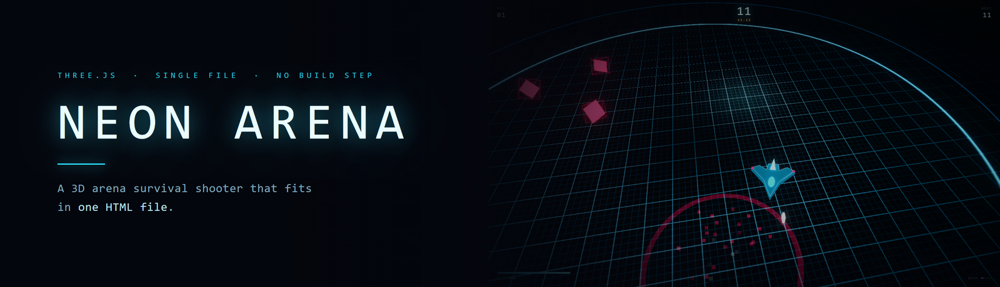
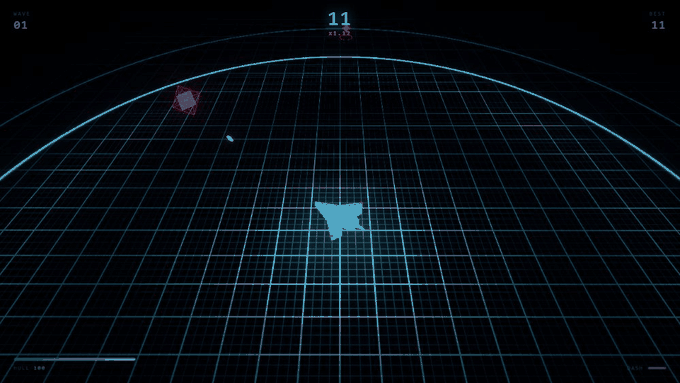
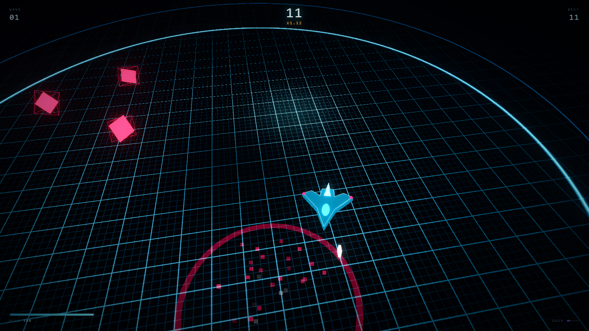
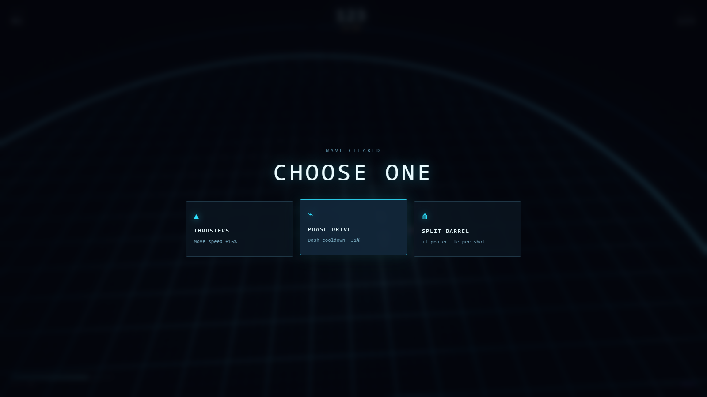

<p align="center">
  
</p>

<p align="center">
  <a href="https://neon-arena-dun.vercel.app"></a>
  
  
  
</p>

<p align="center">
  <b>You don't aim. You position.</b><br>
  <sub>Your cannons lock on automatically — survival is entirely about where you stand.</sub>
</p>

<p align="center">
  
</p>

---

## The game

A gunship. A circular neon arena. Enemies pour in from the rim and you have to out-maneuver them while your guns do the shooting. Clear a wave, pick an upgrade, do it again — until the hull gives out.

It's one file. No bundler, no `node_modules`, no assets folder — every mesh, particle, and sound is generated at runtime.

## What's in it

| | |
|---|---|
| **Auto-targeting guns** | Bullets always fly at the nearest hostile in range. You never aim, so every decision is about position. |
| **Three enemy types** | **Drifters** — fast and fragile. **Brutes** — slow, tanky, hit for a quarter of your hull. **Spitters** — hold range and snipe you. |
| **Eight stackable upgrades** | Fire rate, damage, pierce, extra barrels, hull, speed, dash cooldown. They compound — by wave 10 you're firing a wall of piercing rounds. |
| **Dash with i-frames** | `Space` bursts you forward with brief invulnerability. Dashing *through* a gap beats running from one. |
| **Combo scoring** | Kills within 3.4s chain a multiplier up to ×6. |
| **Health orbs** | Drop from roughly 1 in 7 kills and magnet toward you when you're close. |
| **Procedural audio** | Every sound is synthesized with the Web Audio API. Zero audio files. |
| **Persistent best run** | Saved to `localStorage`. |

## Controls

| Input | Action |
| :--- | :--- |
| `W` `A` `S` `D` / arrow keys | Move |
| `Space` | Dash |
| `P` | Pause |
| `M` | Mute |
| Drag (touch) | Steer |

## Screenshots

<table>
  <tr>
    <td width="50%"></td>
    <td width="50%"></td>
  </tr>
  <tr>
    <td align="center"><sub>Wave 1 — the swarm closes in</sub></td>
    <td align="center"><sub>Clear a wave, pick one of three</sub></td>
  </tr>
</table>

## Under the hood

Everything is procedural, so the whole game is ~1,380 lines in a single `index.html`.

- **Pixel-perfect grid.** The arena floor is a custom fragment shader. Naive grid shaders alias into dotted lines at a distance, so the line width is derived from the camera distance per fragment (`pxw = length(worldPos - camPos) * uPix`) and the mask is built in world units. Lines stay crisp at every angle.
- **Linear vs. sRGB.** Shader colours are linear, then tone-mapped and gamma-encoded on output. Values that *look* reasonable on paper (a `0.07` blue) render far brighter than intended — the dark backdrop needs values down around `0.002`.
- **Bloom.** `UnrealBloomPass` with ACES tone mapping does the neon glow. Emissive intensity is tuned so only edges and projectiles blow out, not the hulls.
- **Object pooling.** Bullets, enemy projectiles, particles, and shockwaves are all preallocated and recycled — no allocation during play, so no GC hitches.
- **Responsive framing.** The camera pulls back as the viewport gets narrower, otherwise the ship fills a phone screen.

## Run it locally

```bash
git clone https://github.com/Shafiur0/neon-arena.git
cd neon-arena
open index.html      # macOS  (or just double-click it)
```

That's the whole setup. It loads three.js from a CDN, so you need an internet connection the first time.

## Deploy your own

[](https://vercel.com/new/clone?repository-url=https://github.com/Shafiur0/neon-arena)

It's a static file — Vercel, Netlify, GitHub Pages, or any static host will do. No build command, no output directory, just serve the folder.

---

<p align="center">
  <sub>Built with <a href="https://threejs.org">three.js</a>. No frameworks, no dependencies, no build step.</sub>
</p>
